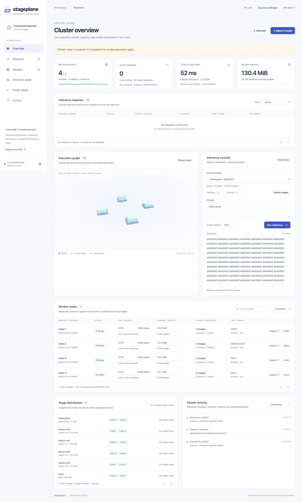

# Stageplane hardening and validation report

Validation date: 2026-11-01. Base revision: `033c960dd8059e3e80066de7b682151d7d9c1499`.
This report describes the accompanying implementation, not an enterprise SLA or
certification of arbitrary model sizes.

## Changes made after the audit

| Area | Problem found | Implemented behavior |
| --- | --- | --- |
| Distribution | Partial builds could be visible; malformed tensor headers and truncated sources were insufficiently checked | Hidden staging, atomic publication, duplicate/shape/offset/layer checks, bounded header/range reads, storage preflight |
| Source credentials | Arbitrary HTTP sources could receive the Hugging Face token | HF credentials are attached only to HF repository retrieval |
| Capacity | Deployments independently reserved the same worker capacity | Cross-deployment reservations, cached artifact disk accounting, resident-copy budgets |
| Rebalancing | Group IDs, gradual resource changes and loading/busy joins could miss the correct replan | Group normalization, planning baselines, independent cooldowns and deferred group-local replanning |
| Migration | Replacing a ready owner could temporarily remove a usable route | Previous ready copies stay assigned during feasible replacement loading and live-session drain |
| Worker lifecycle | Cancellation could release memory accounting before native computation ended | Compute ownership, retained abandoned reservations, release fencing and bounded session contexts |
| Recovery | REST rejections bypassed the bounded retry policy; saturated healthy session owners could be excluded | Worker rejection classification and existing-session routing credit; executor remains retry owner |
| Transport | A large REST response could be buffered without the frame cap | Bounded streamed responses and pre-serialization tensor-size checks |
| Credentials | One shared token was used by all clients | Separate internal worker token, operator/viewer roles and tenant inference keys |
| Request lifecycle | Failed startup/disconnects could leave stale status or worker state | Explicit terminal records, active requests separate from bounded history, shielded tracked cleanup |
| Operations | Stale status, sparse request visibility, expensive unbounded graph, narrow-screen overflow | Polling/reconnect freshness, request/trace detail, normalized resource metrics, pagination and bounded topology |
| Replica health | Assignment count could show full redundancy while a second copy was loading | Readiness counts active, non-draining verified copies; target readiness waits for every assigned copy |
| Maintenance | Drained workers had no explicit return-to-service operation | Authenticated Resume operation with freshness/quarantine checks |

## Verification results

- **104 tests passed**, zero failures/errors/skips, in **60.05 seconds**.
- Coverage includes native logit/token parity for supported tiny model adapters,
  real REST/gRPC/WebSocket worker pools, hard worker loss after token commitment,
  mutual TLS with deterministic network coverage of all three transports,
  concurrent route admission, group isolation, migration warmup, verified replica health,
  client disconnect cleanup, credential boundaries and malformed artifact rejection.
- The real HTTP disconnect regression verifies zero active gateway requests and
  zero worker sessions after cancellation, within its 10-second deadline.
- OpenAPI syntax and Postman collection lint passed. Local smoke collection:
  **3 requests, 10 assertions, zero failures**. No Postman cloud publication was needed.
- Source and wheel builds, Docker Compose configuration and JavaScript syntax passed.
- Browser validation covered desktop 1280px and mobile 390px, authentication
  recovery, streaming completion/cancel, pagination/filtering, request traces,
  worker details and import controls. Drain → Resume → Ready passed against the live
  backend. Cancelling a long response released all four workers’ sessions within
  8 seconds; no active requests remained. No browser console errors were observed.

Raw suite summary: [tests.json](tests.json). The retained Qwen3 4B bundle passed
SHA-256, byte-size, tensor-header and decoder-layer coverage checks: **46 files,
8,060,883,348 bytes, 38 stages, 36 decoder layers and 398 tensors**. Validation took
4.679 seconds without loading tensors into Torch. The reviewed bundle is at
`data/review/qwen3-4b/layer-models/Qwen--Qwen3-4B-Instruct-2507-cdbee75f17c0-l1`
in the original checkout. Evidence: [qwen4b-integrity.json](qwen4b-integrity.json).
Existing large-model inference benchmarks remain in the earlier reports; this
pass does not claim a new 4B or trillion-parameter latency benchmark.

## Concurrent inference on a real local worker pool

Four worker processes used REST, gRPC and WebSocket links and the deterministic
small Qwen3 fixture. Two stage replicas were configured. All processes shared
one Apple Silicon host and loopback networking. This checks execution consistency
and local service behavior; the fixture is not a language-quality benchmark.

| Measurement | Result |
| --- | --- |
| Requests / concurrency | 48 / 4 |
| Maximum output tokens per request | 16 |
| Successful HTTP responses | 48 / 48 |
| Output and usage parity with deterministic baseline | All matched |
| Elapsed time | 3.043 s |
| Request throughput | 15.78 requests/s |
| p50 / p95 request latency | 244.8 / 329.4 ms |
| Active requests after completion | 0 |

Raw trials: [concurrency.json](concurrency.json). Reproduce against a tiny fixture
cluster with `python -m scripts.concurrency_validation --url URL --model MODEL_KEY`.
Use a disposable fixture cluster; worker budgets and other clients affect results.

## Synthetic large-model placement

These tests allocate node and stage metadata only. BF16 weights are represented
by byte counts, with equal whole-stage sizes, two replicas, idle nodes and unique
failure domains. The 10T layout represents 20 TB of weights before replicas.
No 100B/1T/10T tensors, activations or KV caches were downloaded or executed.

| Synthetic size | Virtual workers | Stages | Groups | Initial placement | Failed-worker group replan | Unrelated-group changes |
| --- | ---: | ---: | ---: | ---: | ---: | ---: |
| 100B | 32 | 80 | 4 | 1.40 ms | 0.41 ms | 0 |
| 1T | 128 | 128 | 8 | 4.25 ms | 0.68 ms | 0 |
| 10T | 1,024 | 256 | 16 | 21.29 ms | 2.27 ms | 0 |
| 10T | 10,000 | 256 | 32 | 109.72 ms | 9.47 ms | 0 |

Peak planner-process RSS was 32.8 MiB.
This is metadata memory, not model memory. Timing is a single local observation,
not a latency percentile or registration-throughput measurement. Raw capacities,
assumptions and measurements: [scale.json](scale.json). Reproduce with
`python -m scripts.scale_validation`. CI executes these assertions on each change.

## Remaining boundaries for enterprise and trillion-scale deployment

The implementation still uses one SQLite-backed coordinator. It has no consensus
HA, transferable in-flight streams, external durable request queue, per-tenant
quotas/model entitlements, SSO or immutable audit log. Operator roles are globally
trusted across tenants. Workers and artifact sources must be trusted.

The execution unit is a complete layer/stage. Tensor/expert parallelism, MoE,
continuous batching, paged KV caches and distributed prefill are not implemented.
A single large layer must fit on one worker. Transport still limits frames to
64 MiB, envelopes to 64 KiB and routes to 1,024 hops; large metadata may hit the
envelope limit sooner. Native kernels cannot be forcibly cancelled; a process
supervisor must recover permanently stuck workers. Whole-model interrupted builds
restart, although individual bounded source reads retry transient failures.

The default bundle limit is 256 GiB and must be deliberately increased for larger
models. At BF16, 100B/1T/10T require at least 200 GB/2 TB/20 TB of weight storage per
copy, before caches, workspaces, replicas and staging. Correct synthetic placement
does not establish real inference support at those sizes. Target-hardware tests
with actual supported checkpoints are required before advertising such support.

Operational setup, resource constraints and credential provisioning are documented
in [OPERATIONS.md](../../docs/OPERATIONS.md).

## Dashboard views

[Mobile view](dashboard-mobile.jpg) · [Request execution details](request-detail.jpg)
